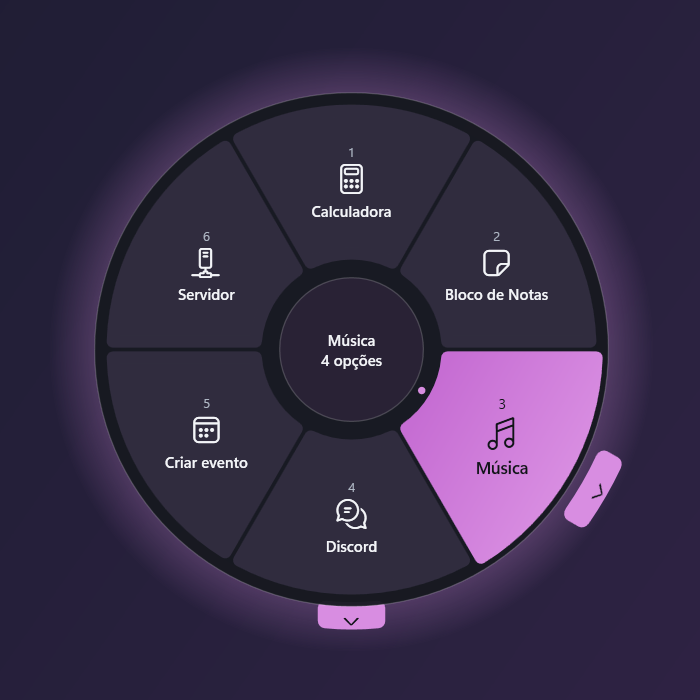
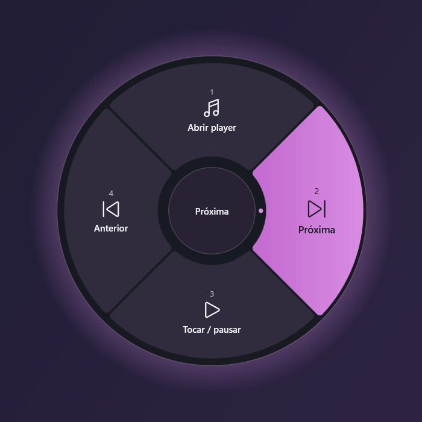
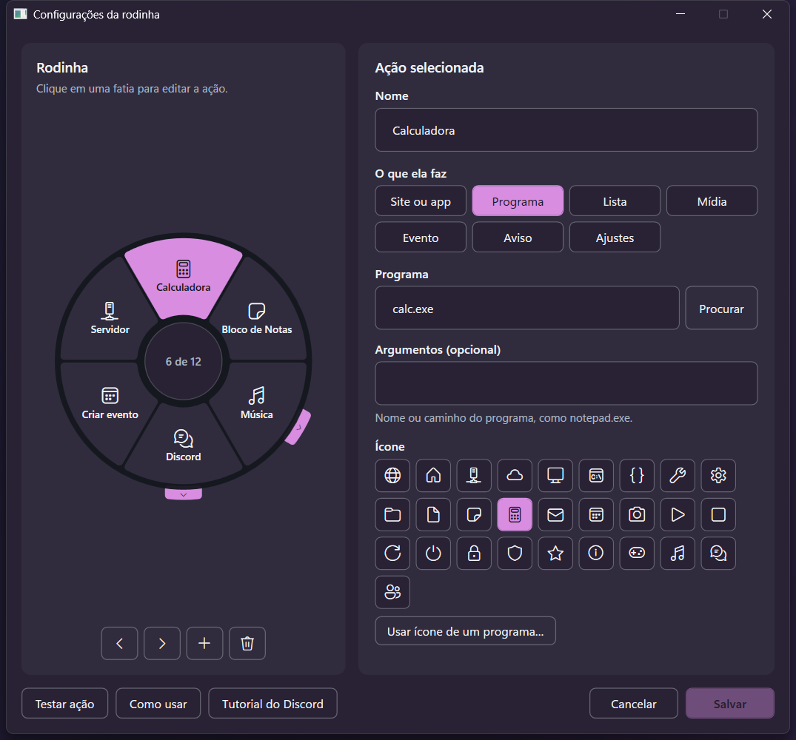
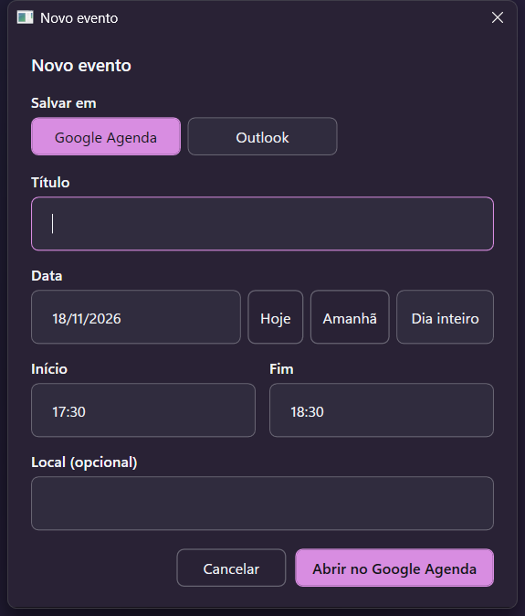
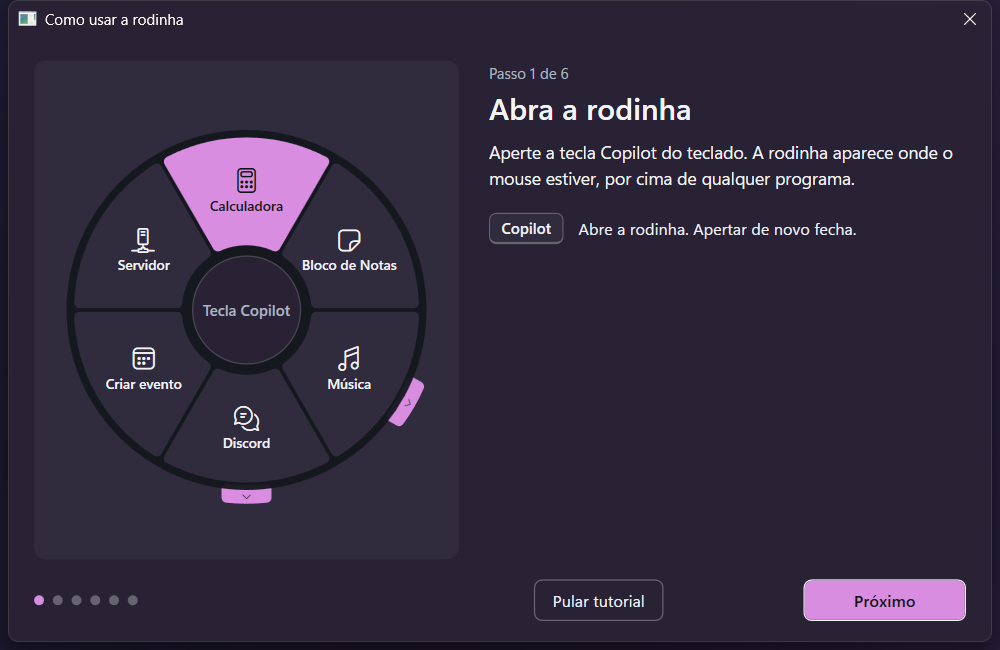

<div align="center">

# 🎡 Ações rápidas

**Aperte a tecla Copilot e escolha uma ação numa rodinha animada.**
Abra sites, programas, jogos, canais do Discord, controle a música e crie eventos no calendário, tudo a um gesto de distância.

[](https://github.com/Luskss/actionswheel/releases/latest)




</div>

---

## ✨ Recursos

- **Tecla Copilot reaproveitada.** Um toque abre a rodinha na posição do mouse, por cima de qualquer programa. Nenhuma janela rouba o foco.
- **Visual do Windows.** Usa a cor de destaque e o tema claro ou escuro do sistema, com animações suaves.
- **Escolha como preferir.** Mouse, teclas de número (1 a 9 e 0) ou setas e Enter.
- **Listas dentro da rodinha.** Fatias com uma aba na borda abrem uma segunda rodinha: jogos da Steam, canais do Discord, controles de música.
- **Ações de vários tipos.** Sites e apps, programas, teclas de mídia, avisos e criação de eventos.
- **Eventos no calendário.** Google Agenda, Outlook ou Nextcloud, com o último destino lembrado.
- **Tudo editável por uma janela.** Nada de mexer em arquivo, a menos que você queira.
- **Tutoriais embutidos.** Um passo a passo geral e outro só sobre canais do Discord.

## 🖼️ Telas

<table>
  <tr>
    <td align="center"><br><sub>Listas abrem uma segunda rodinha</sub></td>
    <td align="center"><br><sub>Configurações com prévia ao vivo</sub></td>
  </tr>
  <tr>
    <td align="center"><br><sub>Novo evento: Google, Outlook ou Nextcloud</sub></td>
    <td align="center"><br><sub>Tutorial passo a passo</sub></td>
  </tr>
</table>

## 📥 Instalação

1. Baixe o `.zip` mais recente em [**Releases**](https://github.com/Luskss/actionswheel/releases/latest).
2. Extraia e execute o `AcoesRapidas.exe`. Não precisa instalar o .NET.
3. O app fica na bandeja do sistema, perto do relógio. Na primeira vez, um tutorial abre sozinho.

> [!NOTE]
> O executável não é assinado digitalmente, então o Windows SmartScreen pode avisar na primeira execução. Se preferir, [compile você mesmo](#-compilando).

**Requisitos:** Windows 11 e um teclado com a tecla Copilot.

### Configure a tecla Copilot

O app reconhece o sinal padrão da tecla Copilot (`Win` + `Shift` + `F23`). Se a sua tecla foi remapeada para outra função, como Ctrl direito, volte para o padrão em **Configurações do Windows › Personalização › Entrada de texto**. Depois disso, a tecla deixa de abrir o Copilot e abre a rodinha.

Para ver exatamente o que o teclado envia, rode `AcoesRapidas.exe --diagnostico`.

## 🎮 Como usar

| Gesto | O que faz |
|---|---|
| **Tecla Copilot** | Abre a rodinha. Apertar de novo fecha. |
| **Apontar e clicar** | Escolhe a fatia na direção do mouse, sem precisar mirar no ícone. |
| **1 a 9 e 0** | Escolhe a fatia com esse número. |
| **← → ↑ ↓ e Enter** | Anda pelas fatias e confirma. Alcança também as que não têm número. |
| **Esc, Backspace ou botão direito** | Volta um nível. Na rodinha principal, fecha. |
| **Clicar no centro** | Também volta ou fecha. O centro diz o que vai acontecer. |

## ⚙️ Personalização

Clique no ícone da rodinha na bandeja para abrir as configurações: dá para adicionar, mover, renomear e excluir fatias, trocar ícones (da fonte do Windows ou de qualquer programa) e testar cada ação antes de salvar. Os botões **Como usar** e **Tutorial do Discord** ensinam o resto.

### Tipos de ação

| Tipo | Para que serve | Exemplo de destino |
|---|---|---|
| `url` | Site ou app | `https://example.com`, `steam://rungameid/ID`, `discord://-/channels/SERVIDOR/CANAL`, `spotify:` |
| `command` | Abrir um programa | `notepad.exe`, com argumentos opcionais |
| `menu` | Abrir uma segunda rodinha | lista de ações em `children` |
| `media` | Tecla de mídia | `playpause`, `next`, `previous`, `stop` |
| `event` | Criar um evento no calendário | endereço do Nextcloud (opcional) |
| `toast` | Mostrar um aviso | o texto do aviso |
| `settings` | Abrir as configurações | não usa destino |

Colar o link de um canal do Discord ou de uma música do Spotify nas configurações já converte para o endereço que abre direto no app, e não no navegador.

### Arquivo de configuração

Fica em `%APPDATA%\AcoesRapidas\config.json`. Aceita comentários e vírgulas sobrando.

```jsonc
{
  "actions": [
    { "label": "Notas", "icon": "E70B", "type": "command", "target": "notepad.exe" },
    { "label": "Painel", "icon": "E774", "type": "url", "target": "http://192.168.0.10:8080" },
    {
      "label": "Música", "icon": "E8D6", "type": "menu",
      "children": [
        { "label": "Tocar / pausar", "icon": "E768", "type": "media", "target": "playpause" },
        { "label": "Próxima", "icon": "E893", "type": "media", "target": "next" }
      ]
    },
    { "label": "Criar evento", "icon": "E787", "type": "event", "target": "https://nuvem.exemplo.com" }
  ]
}
```

O campo `icon` é um código da fonte *Segoe Fluent Icons* (`E774`). Para usar o ícone de um programa, informe `iconPath` com o caminho dele. Limites: de 2 a 12 fatias na rodinha principal, até 8 opções por lista e até três níveis de listas. Se o arquivo tiver um erro, o app avisa e mantém a última configuração válida.

## 📅 Eventos no calendário

A fatia de evento abre uma janela com título, data, horário e local. Datas aceitam `hoje`, `amanhã`, `25/12` e `25/12/2026`; horários aceitam `14h30` e `14:30`.

| Destino | Como funciona |
|---|---|
| **Google Agenda** e **Outlook** | Abrem o navegador com o evento já preenchido, e você confirma lá. O app não guarda login nem senha desses serviços. |
| **Nextcloud** | Cria o evento direto por CalDAV. A autorização é feita uma vez, pelo navegador, e o app guarda uma senha própria de aplicativo, criptografada para o seu usuário do Windows. Você pode revogá-la nas configurações de segurança do Nextcloud. |

O Nextcloud aparece como opção quando o `target` da ação tem o endereço dele. Endereços `http` só são aceitos em redes privadas (incluindo Tailscale); fora delas, use `https`. A janela lembra o último destino escolhido.

## 🔒 Segurança e privacidade

- Links são limitados a `http`, `https`, `steam`, `discord` e `spotify`.
- Programas rodam sem privilégios de administrador, com os mesmos direitos do seu usuário.
- O app só usa a rede para criar eventos no Nextcloud. Não há telemetria.
- Se uma janela de administrador estiver em foco, o Windows não entrega a tecla a um app comum, então a rodinha não abre naquele momento.

## 🔨 Compilando

Precisa do [.NET 10 SDK](https://dotnet.microsoft.com/download) no Windows.

```powershell
# Rodar os testes
dotnet test AcoesRapidas.Tests/AcoesRapidas.Tests.csproj -c Release

# Compilar
dotnet build AcoesRapidas/AcoesRapidas.csproj -c Release

# Gerar um executável único, que não depende do .NET instalado
dotnet publish AcoesRapidas/AcoesRapidas.csproj -c Release -r win-x64 --self-contained true `
  -p:PublishSingleFile=true -p:IncludeNativeLibrariesForSelfExtract=true `
  -p:EnableCompressionInSingleFile=true -p:DebugType=None -o dist
```

A saída de compilação vai para `%LOCALAPPDATA%\AcoesRapidas\build`, fora da pasta do projeto, para evitar bloqueios de arquivo por serviços de sincronização como o OneDrive.

### Opções de linha de comando

| Opção | Efeito |
|---|---|
| `--mostrar-menu` | Abre a rodinha ao iniciar |
| `--configuracoes` | Abre as configurações |
| `--tutorial` / `--tutorial-discord` | Abre um dos tutoriais |
| `--diagnostico` | Mostra as teclas recebidas pelo teclado |
| `--tema=claro\|escuro` | Força o tema |
| `--destaque=#RRGGBB` | Força a cor de destaque |

## 🧩 Como funciona por dentro

- **Captura da tecla:** um hook global de teclado (`WH_KEYBOARD_LL`) detecta a sequência da tecla Copilot, bloqueia o `F23` e injeta uma tecla neutra para o menu Iniciar não abrir. A detecção é uma máquina de estados separada da API do Windows, o que a deixa testável.
- **Rodinha:** duas janelas. Uma ocupa a tela inteira só para receber o mouse, e outra, pequena e transparente, desenha o anel animado sem ser redesenhada a cada movimento.
- **Tecnologias:** C#, .NET 10, WPF, xUnit.

```
AcoesRapidas/         aplicativo
  Actions/            execução das ações
  Calendar/           Google, Outlook e Nextcloud (CalDAV)
  Config/             leitura, validação e gravação da configuração
  Input/              hook do teclado e detecção da tecla Copilot
  UI/                 rodinha, configurações, evento e tutoriais
AcoesRapidas.Tests/   testes automatizados
```
